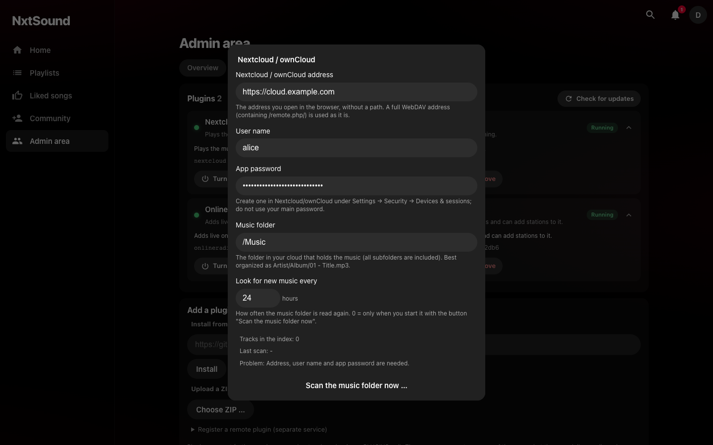

<div align="center">

# NxtSound plugin: Nextcloud / ownCloud

**Your cloud's music folder, as part of your own music server.**

[](https://github.com/nxtsound/nxtsound-plugin-nextcloud/actions/workflows/ci.yml)
[](LICENSE)


</div>

A plugin for the [NxtSound server](https://github.com/nxtsound/nxtsound-server). It plays the music in a folder of your **Nextcloud** or **ownCloud**
(any WebDAV server with the same layout works too). Search, artists, albums and streaming with seeking work like with your own library;
the files stay where they are, and the plugin stores nothing but a small index.

<p align="center">
  
</p>

## Features

- ☁️ Music from **Nextcloud, ownCloud or any WebDAV** folder next to your local library
- 🔎 **Instant search** (the folder is indexed once, so searching never waits for the cloud), ignoring case and accents: `cafe mull` finds `Café Müller`
- 🗂 Artists and albums from your **folder and file names** (several common layouts, disc folders, compilations)
- ⏩ **Streaming with seeking**; the file is passed through from the cloud
- 🔄 **Cheap rescans**: only folders whose ETag changed are read again; a rescan of an unchanged library is a single request
- 🔐 Uses an **app password**; the password is never shown again after saving
- 🧪 Tested without network (the cloud is simulated)

## Install

You need a running [NxtSound server](https://github.com/nxtsound/nxtsound-server) and admin rights.

**In the admin area (easiest):** Plugins → enter `https://github.com/nxtsound/nxtsound-plugin-nextcloud` → **Install**.

**By hand:**

```sh
cd /path/to/nxtsound-server/plugins        # Docker setup: the ./plugins folder next to docker-compose.yml
git clone https://github.com/nxtsound/nxtsound-plugin-nextcloud nextcloud
# then restart the server
```

The folder must be called `nextcloud` (it has to match the plugin's id).

## Set up

1. In Nextcloud or ownCloud create an **app password**: Settings → Security → Devices & sessions. Do not use your main password.
2. In NxtSound open the plugin's gear button (Admin area → Plugins) and fill in the address, user name, app password and the music folder, then press **Save**.
3. Press **Test the connection**, then **Scan the music folder now**. Reading runs in the background; "Tracks in the index" shows the progress.

| Setting | Meaning |
|---|---|
| Nextcloud / ownCloud address | The address you open in the browser, without a path (`https://cloud.example.com`; `cloud.example.com` is fine too, `https://` is added; use `http://` explicitly for a server in your home network). A subfolder install (`https://example.com/nextcloud`) works; a full WebDAV address containing `/remote.php/` is used as it is. |
| User name, app password | The login. The password is stored in the server's database (and therefore in its backups) and is never shown again; leave the field empty to keep it. |
| Music folder | The folder with the music, e.g. `/Music`; all subfolders are included. |
| Look for new music every | How often the folder is read again (0–168 hours, default 24; 0 = only by hand). |

Changing the address, user, password or folder starts over with a fresh index.

## How your folders should look

Artist, album and title come from folders and file names, with rules similar to the NxtSound library:

| Layout | Result |
|---|---|
| `Artist/Album/01 - Title.mp3` | artist, album, track 1, title |
| `Artist - Title.mp3` | artist and title |
| `Artist/2020 - Album/…` or `Artist/Album (2020)/…` | with year |
| `Artist/Album/CD1/…` | disc folders are understood |
| `Various Artists/Album/Queen - Song.mp3` | compilation folders: the artist comes from the file name |

Tags inside the files are **not** read (that would mean downloading every file), so organize your folders. `Artist/Song.mp3` is read as album `Artist`.
Formats: mp3, m4a, aac, flac, ogg, opus, wav, aiff, wma (what plays depends on your device). There are no cover pictures.

## Good to know

- Streaming passes the file through from the cloud (Range requests are forwarded); nothing is stored by the plugin.
- Your cloud is contacted from the **server**, not from your phone, so the server must be able to reach it.
- The password lives in the NxtSound database. Treat backups of it like a password file.

## Development

```sh
python3 -m venv .venv && .venv/bin/pip install -r requirements-dev.txt
PLUGIN_TOKEN=secret .venv/bin/uvicorn app:app --port 8100
.venv/bin/python -m pytest -q          # tests without network: the cloud is simulated
```

| File | Purpose |
|---|---|
| `app.py` | HTTP interface following plugin protocol v1 (search, suggestions, artist, album, stream, settings, actions) |
| `dav.py` | the WebDAV client (list a folder, open a file) |
| `catalog.py` | the index: naming rules, scanning with ETags, searching |
| `settings.py` | the settings the admin sets in NxtSound |

The protocol is described in the server's [plugin guide](https://github.com/nxtsound/nxtsound-server/blob/main/PLUGINS.md).
`tests/vendor/` holds a copy of the server's protocol check (`pluginproto.py`, `plugincheck.py`); after a protocol change, copy them again and in `plugincheck.py` change `import pluginproto` to `from . import pluginproto`.

## Status and roadmap

**Alpha.** It works and has tests, but the plugin system it runs on is young.
Ideas: reading tags for better metadata, cover pictures, keeping favorite songs offline. Pull requests are welcome, see [CONTRIBUTING.md](CONTRIBUTING.md).

## Support

This plugin is part of the NxtSound project; ways to support it are on the [server's page](https://github.com/nxtsound/nxtsound-server#support-the-project).
Bugs and ideas: [open an issue](https://github.com/nxtsound/nxtsound-plugin-nextcloud/issues).

## License

MIT, see [LICENSE](LICENSE).
